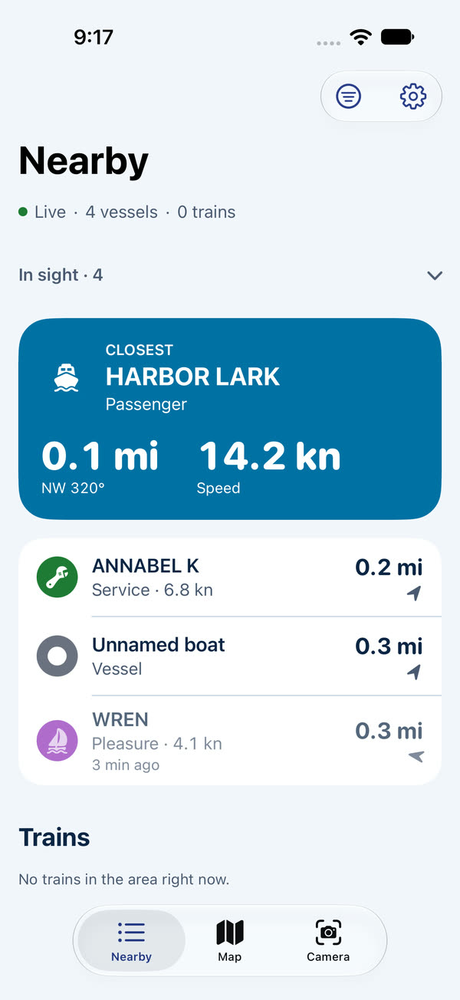
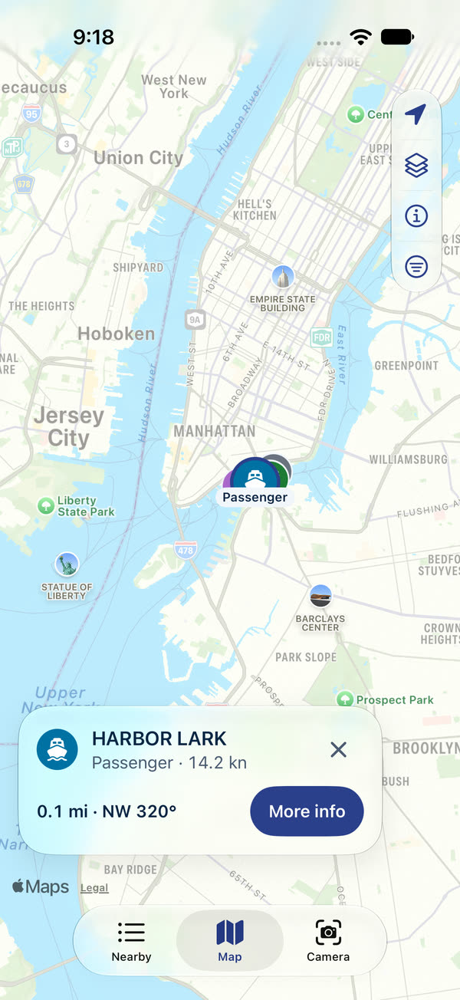
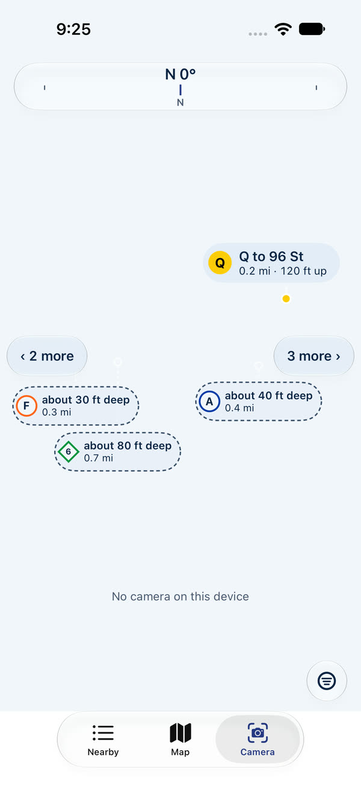
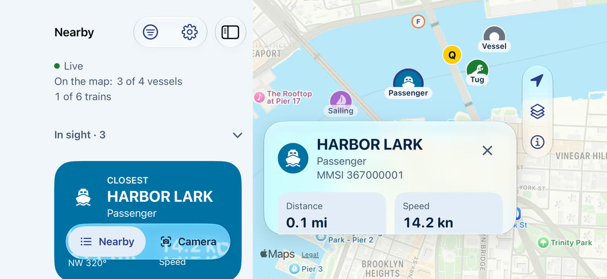
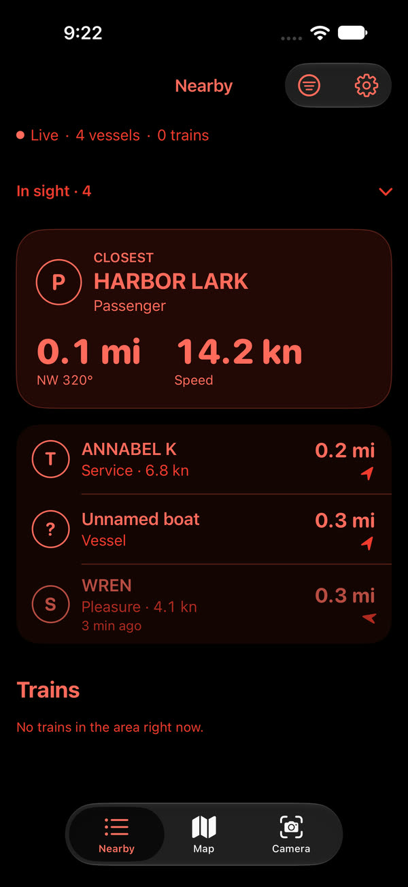
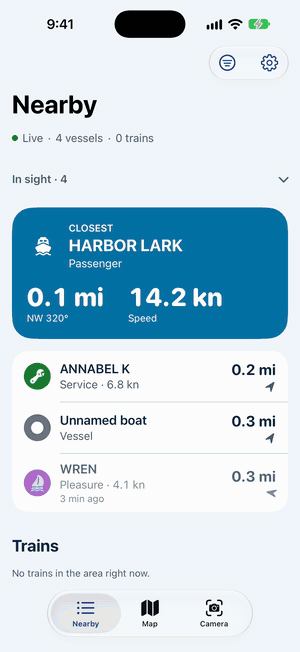
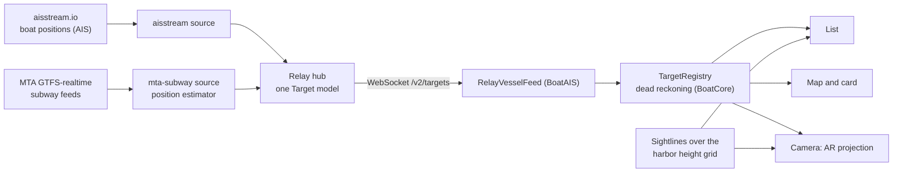

# Bridgewatch

Bridgewatch is an iPhone app that shows the boats and subway trains around the Upper Bay and the lower East River, and labels the ones you can see when you hold the camera up. It works out what is hidden behind buildings and land, and lists trains that are underground separately.

It was written for the iPhone 18 Pro and the foldable iPhone Duo (iOS 27), and every screen works folded, unfolded and while the phone is being opened. It is in TestFlight beta and is not on the App Store.

| Nearby | Map, a boat selected | Camera |
| :---: | :---: | :---: |
|  |  |  |

| Unfolded layout, list beside the map | Night mode |
| :---: | :---: |
|  |  |

The pictures come from the simulator with invented boats and trains; the simulator has no camera, so the camera view shows a placeholder where the video would be. The iPhone Duo simulator has only the cover screen, so the unfolded layout is shown on an iPhone 18 Pro turned to landscape with the same regular-width layout forced on. An 18-second walk through the list, the map and the camera:



## How it works



The relay is the only thing that talks to the data providers (aisstream does not allow direct client connections, and its key must stay on a server). Each provider is a source plug-in that publishes targets in one model, whether the target is a boat, a train or, later, an aircraft. The app connects to the relay over a WebSocket and keeps the latest report of each target. Between reports it carries a boat forward along its course. For every target it asks whether land or a roof is in the way, and the camera view projects what remains onto the screen from the phone's position, compass heading and the camera's field of view.

## What is interesting in the code

- **Where a subway train is.** MTA's feeds carry no GPS: a train reports the station it last stood at or is heading to, plus predicted times at the stations ahead. [`relay/src/subway.ts`](relay/src/subway.ts) places each train along the real track between stations in proportion to time. Underground track gets a depth model (station depths, river tubes, ramps at portals) in [`relay/src/tools/depth.ts`](relay/src/tools/depth.ts), so the app can tell a train on the Manhattan Bridge from one in the tunnel below.
- **What can be seen from where you stand.** [`Sightlines.swift`](Packages/BoatCore/Sources/BoatCore/Sightlines.swift) checks the line from your eye to a target against a 50 m grid of roof and ground heights ([`HarborSurface.swift`](Packages/BoatCore/Sources/BoatCore/HarborSurface.swift), built from building footprints and shorelines). The eye height comes from GPS altitude when GPS vouches for it, and otherwise from a height you set by hand. [`docs/DESIGN.md`](docs/DESIGN.md), "Sightlines", lists what is rough on purpose.
- **A map card that never covers what matters.** [`MapCardLayout.swift`](Packages/BoatCore/Sources/BoatCore/MapCardLayout.swift) is a pure function that picks where the selected boat's card docks, so it clears the marker, the map buttons, banners and the map's own attribution, and moves when one of them does.
- **A foldable phone.** The hinge is read in one place, [`HingeMonitor.swift`](App/HingeMonitor.swift), and exposed to SwiftUI; views never touch UIKit. Layout comes from the container size, with no fixed widths and no orientation lock, so unfolding in the middle of a screen is just another size change.
- **AR math with no assumed phone.** [`ARProjection.swift`](Packages/BoatCore/Sources/BoatCore/ARProjection.swift) takes the real view size and camera field of view as inputs, and each point's true elevation, so a train on a bridge sits above the horizon and one in a tunnel below it.
- **A test harness for a machine shared with other work.** [`scripts/ui-test.sh`](scripts/ui-test.sh) is the only way simulator tests run: one run at a time, machine-wide, behind a lock; reserved simulators; a preflight that refuses a busy machine with its own exit code (75, "not a test failure"); and results written where any later session can read them. On top of that sits a chaos tier (hostile relay frames, dropped and stalled connections, a seeded monkey that taps the app) whose findings are in [`docs/CHAOS-FINDINGS.md`](docs/CHAOS-FINDINGS.md), next to a code-level crash review in [`docs/CRASH-HUNT.md`](docs/CRASH-HUNT.md).
- **Source plug-ins and a health-gated deploy.** New feeds go in [`relay/src/sources/`](relay/src/sources/) and are switched on by the `SOURCES` setting; a failing source cannot take the others down ([`guard.ts`](relay/src/guard.ts)). [`deploy/relay/deploy.sh`](deploy/relay/deploy.sh) builds the image, replaces the container, waits for `/healthz` to show live data (not just a running server), and rolls back if it does not.
- **No recorded data.** Every fixture is synthetic: the AIS frames are hand-written, and the subway feeds are generated from a scenario ([`relay/src/tools/subway-scenario.ts`](relay/src/tools/subway-scenario.ts)) that says, trip by trip, where each train should end up. A relay test fails if a committed fixture differs from the generator's output.

## Build and run

You need a Mac with Xcode 27.1 and the iOS 27 simulator runtimes. The app builds without any configuration: with no relay address it shows only what it is given.

```sh
git clone <this repository> bridgewatch && cd bridgewatch
scripts/demo.sh        # builds the app and launches it in the iPhone 18 Pro simulator with invented boats and trains
```

`scripts/demo.sh "iPhone Duo"` does the same on the foldable. The boats and trains are made up and their report times are "now", so they stay on screen for about ten minutes. To point the app at a real relay, see [`docs/DEVELOPMENT.md`](docs/DEVELOPMENT.md) and [`relay/README.md`](relay/README.md); the relay needs Node 22 and its own aisstream key.

## Tests

```sh
(cd Packages/BoatCore && swift test)
(cd Packages/BoatAIS && swift test)
(cd relay && npm ci && npm test)
scripts/ui-test.sh smoke         # the UI smoke tests, on reserved simulators it creates on first use
```

`scripts/ui-test.sh full` runs every UI test on an iPhone 18 Pro and an iPhone Duo simulator and builds the Release configuration. Nothing in any test touches a live service. How the script, the lock and the opt-in tiers (performance, chaos, screenshot tours) work is in [`docs/DEVELOPMENT.md`](docs/DEVELOPMENT.md).

## Data sources and credits

The same credits are shown in the app, under Settings, About, Data and credits. [`THIRD_PARTY_NOTICES.md`](THIRD_PARTY_NOTICES.md) lists each source and what it is used for.

- Boat positions come from AIS, the radio signal boats broadcast, by way of [aisstream.io](https://aisstream.io).
- Train positions are estimated from MTA's real-time subway feeds and static GTFS data. Transit data: MTA. **Not affiliated with or endorsed by the MTA.** Data provided as is and may be inaccurate, incomplete or delayed.
- Maps are Apple Maps.
- Roof and ground heights come from NYC Open Data (Building Footprints, NYC OTI) and shorelines from US Census Bureau TIGER/Line.
- Track heights and ground elevations use USGS 3DEP data (U.S. Geological Survey). Tunnel portals and a few stretch ends were placed by hand using OpenStreetMap, © OpenStreetMap contributors.

Positions can be late or wrong. Do not use this app for navigation or safety.

## Status

TestFlight beta with a small group of testers. Not on the App Store, and the relay the beta uses is private. The default observer position in the tests and the demo (40.7046, -73.9913) is the Brooklyn Bridge Park waterfront.

## Rights

The source is shared here for reference. All rights are reserved: no license is granted to copy, modify or redistribute it.

## Built with

Built by one person directing Claude Code agents. [`CLAUDE.md`](CLAUDE.md) is the standing instruction file those agents work from: the stack, the architecture and the rules a change has to follow.
